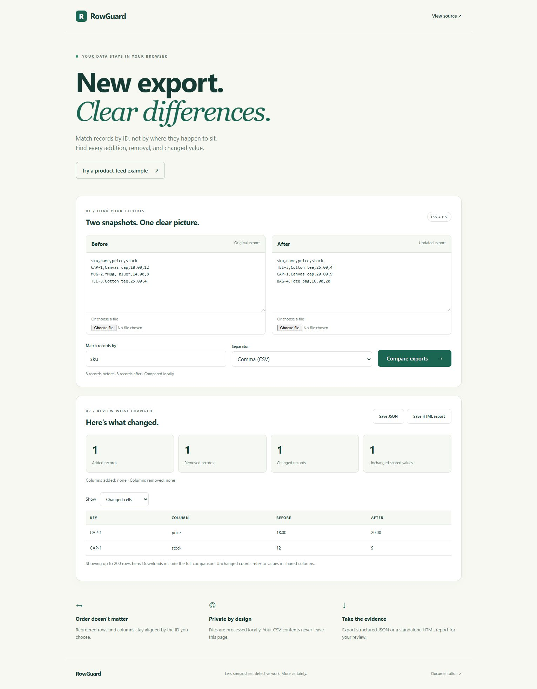

# RowGuard

Compare two CSV exports by a unique ID instead of line position. Find added,
removed, and changed records even when the exports have different row orders.
Get a readable HTML report without uploading your files.

Use the browser app to compare exports without uploading your data, or run the CLI with Node.js 20+. No dependencies or API keys are required.



## Browser app

Paste two exports or choose CSV/TSV files, set the ID column, and compare.
Review added, removed and changed records, then download JSON or an HTML report.
Use the built-in sample to try it immediately. Files are processed in the browser.

```sh
npm run build
npm run preview
```

Open http://127.0.0.1:4173. Browser inputs are limited to 2 MiB each; the table
shows up to 200 rows while downloads include the full comparison.

## Command line
Run commands from the repository root:

```sh
npm run demo
npm test
node src/cli.mjs examples/before.csv examples/after.csv --key sku --format json
node src/cli.mjs examples/before.csv examples/after.csv --key sku --format html --out report.html
```

Open `report.html` in any browser. A checked-in example is in
[examples/report.html](examples/report.html). The example compares product feeds:
one added product, one removed product, and one product with changed price/stock.

```text
Rows: 3 before → 3 after
Added: 1 | Removed: 1 | Changed: 1 | Unchanged shared values: 1
```

## Automation and TSV

```sh
node src/cli.mjs old.csv new.csv --key id --fail-on-change
node src/cli.mjs old.tsv new.tsv --key id --delimiter tab --format json
```

Exit codes: **0** successful comparison; **1** differences found when
`--fail-on-change` is set; **2** invalid input or an I/O error. Output files must
be new: RowGuard refuses to overwrite an existing report or source file.

## Comparison rules

- Keys must be present, nonblank, and unique in each input. Duplicate keys stop
  comparison with the file label and logical record number.
- Row order and column order do not matter. Key and cell values are exact text:
  `001` differs from `1`, and `20.00` differs from `20`. No numeric coercion.
- Added and removed columns are reported separately. Changed cells compare only
  shared non-key columns. The unchanged count means unchanged *shared values*,
  even when the schema has changed.
- Supports quoted commas, multiline fields, escaped quotes, BOM, CRLF, LF,
  and explicit single-character separators. Blank physical lines are ignored.
- Duplicate/blank column names, malformed quoting, and uneven records fail.

## Limits and privacy

UTF-8 CSV/TSV only, at most 20 MiB per input. Parsing and comparisons use memory;
this is not a streaming tool for multi-gigabyte exports. No XLSX support, fuzzy
matching, composite keys, automatic delimiter detection, or normalization.

The CLI makes no network requests. Reports contain the compared values, so
choose where to save/share them accordingly. HTML data is escaped, scripts are
absent, and a content security policy blocks external resources.


## Architecture

The browser app and CLI share the same CSV parser and key-aware comparison engine.
The website uses plain HTML, CSS and JavaScript modules. A small build script
copies the browser assets and shared modules into `dist/`.

## Deployment

Import this repository into Vercel. The included `vercel.json` configures
`npm run build` and the `dist` output directory. No environment variables are needed.

## Development

`npm test` runs parser, comparison, CLI and HTML-escaping tests. The website can
be previewed locally with the commands above.
